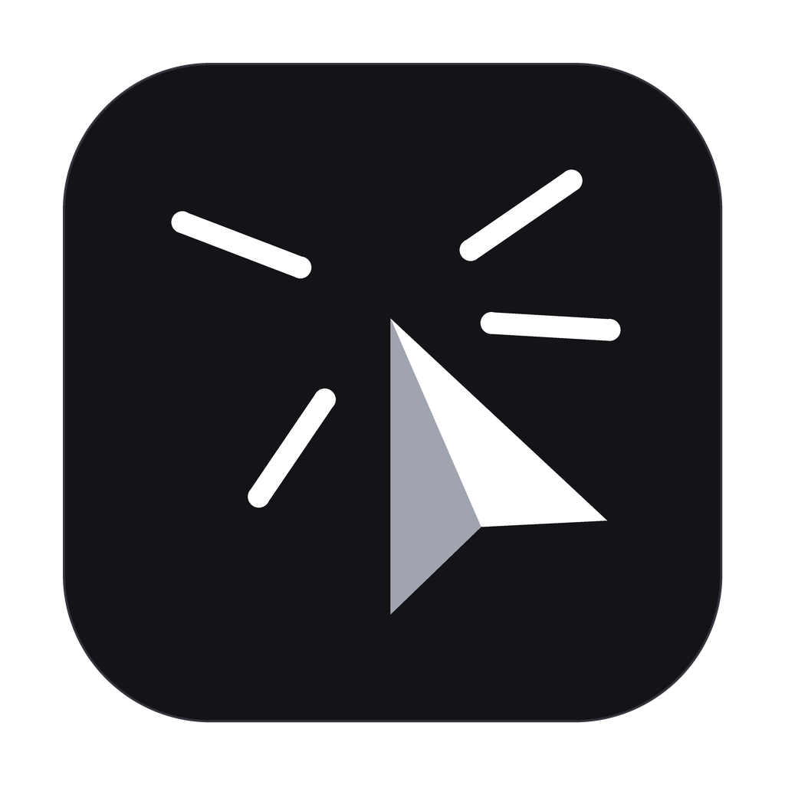

# AutoCliX

<p align="center">
  
</p>

<p align="center">
  <strong>A distraction-free, native macOS menu bar auto-clicker engineered with Quartz event injection, configurable click rates (1–900 CPS), start delays, automated stop limits, and global keyboard shortcuts.</strong>
</p>

<p align="center">
  <a href="https://github.com/unamatasanatarai/autoclix/releases/latest">
    
  </a>
</p>

<p align="center">
  <a href="#why-autoclix"></a>
  <a href="#technical-architecture"></a>
  <a href="#license"></a>
  <a href="#verification--testing"></a>
</p>

---

AutoCliX is a lightweight, offline utility designed to automate repetitive mouse clicking directly at the macOS window server level. It lives exclusively in your menu bar, remaining completely out of your Dock while providing hardware-grade click automation with sub-millisecond dispatch accuracy.

Whether you need sustained clicking at high frequencies, an exact click count ceiling, or a delayed start to position your cursor before automation begins, AutoCliX provides immediate control without the bloat of web wrappers or background telemetry.

---

## Why AutoCliX

Most click automation tools on macOS suffer from common issues: heavy electron runtimes, simulated DOM events that fail in native applications, unstable accessibility permissions that reset on every update, or accidental quit triggers during intense tasks.

AutoCliX was designed to solve these exact friction points:

* **True System-Level Clicks:** Dispatches genuine Quartz HID events (`.cghidEventTap`) that work seamlessly across desktop applications, games, and native macOS utilities.
* **Predictable Automation Controls:** Set precise click limits, timed durations, or countdown delays so clicking stops automatically without manual babysitting.
* **Distraction-Free Menu Bar HUD:** Operates as an `LSUIElement` floating panel that never steals window focus, clutters the Dock, or disrupts your workflow.
* **Failsafe Operation:** Built with a double ⌘Q quit guard, instant keyboard hotkey abort, and automatic session shutdown when your Mac sleeps.
* **100% Private & Local:** Zero telemetry, no network calls, and instant local state persistence.

---

## Key Capabilities

### Quartz Event Injection Engine
Generates system-level mouse down and up events using Core Graphics Quartz Event Services (`CGEventSource.combinedSessionState`). Each click incorporates an engineered 6ms micro-dwell between press and release, ensuring target software reliably registers every actuation even at peak frequencies.

### Precision Click Frequency (1 to 900 CPS)
Configure any click speed between 1 and 900 clicks per second (default: 8 CPS). Fine-tune values effortlessly using keyboard modifier stepping:
* **Default Click:** ±1 CPS
* **Control (⌃):** ±1 CPS (or ±0.1s for decimal durations)
* **Option (⌥):** ±5 CPS
* **Command (⌘):** ±10 CPS

### Primary, Secondary & Middle Button Dispatch
Switch instantly between **Left** (Primary), **Right** (Secondary), and **Middle** (Center / Scroll Wheel) clicks with zero input lag.

### Three-Way Automated Session Controls
Automate sessions with modular, stackable triggers:
* **Start after:** Configurable pre-session countdown (down to 0.0001s, default 3s) allowing you to position the pointer before clicking starts.
* **Stop after:** Session duration timer that halts the engine automatically after an elapsed time window (default 10s).
* **Clicks count:** Exact click ceiling (default 42, configurable up to 10,000,000 clicks) that stops clicking immediately when reached.

### Global Carbon Keyboard Shortcut
Start or stop clicking from any application using a system-wide Carbon hotkey (`RegisterEventHotKey`). Comes pre-configured to `⌥A` and includes instant one-click presets for `⌥Space`, `⌥S`, `⌥C`, `⌥X`, `⌃⌥A`, `F6`, `F7`, and `F8`, with automated conflict detection.

### Real-Time Session Telemetry
Monitor live session performance through an integrated HUD that displays:
* Total delivered clicks count
* Elapsed session timer (`mm:ss`)
* Effective real-time clicks per second (CPS)

---

## How It Works

```
1. Position Cursor ──▶ 2. Trigger Shortcut (⌥A) ──▶ 3. Optional Countdown (3s) ──▶ 4. Quartz Dispatch ──▶ 5. Auto-Stop (At 42 clicks)
```

1. **Configure Parameters:** Select your target button (Left/Middle/Right), set your desired CPS, and toggle your limits (e.g., stop after 42 clicks).
2. **Move Pointer:** Position your mouse cursor over the target location.
3. **Engage Engine:** Tap the global shortcut (`⌥A`) or click the centered play button in the menu bar panel.
4. **Hands-Free Automation:** AutoCliX dispatches down/up event pairs directly at your current cursor position while tracking live telemetry.
5. **Safe Completion:** The session halts automatically when your limit is reached, or instantly whenever you press the shortcut again.

---

## What Makes It Different

| Capability | Standard Utilities | AutoCliX |
| :--- | :--- | :--- |
| **Event Pipeline** | Accessibility API or JS bridges | Native Quartz HID Event Tap (`.cghidEventTap`) |
| **Down/Up Dwell** | Uncontrolled / Zero delay (dropped clicks) | Engineered 6ms micro-dwell for guaranteed actuation |
| **Workspace Presence** | Heavy Dock window | Native Menu Bar panel (`LSUIElement`), no Dock icon |
| **Focus Handling** | Steals keyboard and window focus | Non-activating floating panel with unfocused inputs |
| **Quit Safety** | Single ⌘Q closes app during clicking | Double ⌘Q confirmation guard prevents accidental exit |
| **TCC Permissions** | Broken on every unsigned build | Stable ad-hoc designated code signing requirement |
| **System Sleep** | Continues running / hangs system | Automatic pause and cancel via `NSWorkspace.willSleepNotification` |

---

## Quick Start

### 1. Download Pre-built App (Recommended)

Get the styled DMG installer directly from the [Latest Release](https://github.com/unamatasanatarai/autoclix/releases/latest):

1. Download the `.dmg` from [GitHub Releases](https://github.com/unamatasanatarai/autoclix/releases/latest).
2. Open the disk image and drag **AutoCliX** into your **Applications** folder.
3. Launch AutoCliX from Spotlight or `/Applications`.

### 2. Build and Launch from Source

Compile with Whole-Module-Optimization and launch immediately:

```bash
make run
```

### Run Existing Build

Launch the compiled app directly without triggering a rebuild, preserving your macOS Accessibility authorization signature:

```bash
make launch
```

---

## Installation

### Install to Applications Folder

```bash
make install
```

AutoCliX will be compiled and copied directly to `/Applications/AutoCliX.app`.

### Build Distributable DMG

To generate a standalone, styled `.dmg` installer with an Applications symlink:

```bash
make dmg
```

The resulting package will be placed in `build/AutoCliX-1.0.0.dmg`.

---

## macOS Accessibility Permissions

macOS requires Accessibility permissions (`AXIsProcessTrusted`) to inject system-level input events.

1. When you first start clicking or click the menu bar icon, AutoCliX will prompt you to grant access.
2. Click **Grant Permission** to open **System Settings > Privacy & Security > Accessibility**.
3. Enable **AutoCliX**.

> **Note for Developers:** `scripts/build.sh` automatically signs the binary using a designated requirement identity (`=designated => identifier "com.citizen.autoclix"`). This ensures macOS preserves your TCC Accessibility approval across local rebuilds.
>
> If you ever need to reset permissions for clean testing, run:
> ```bash
> make revoke
> ```

---

## Verification & Testing

AutoCliX includes an automated test and compilation verification suite:

```bash
make test
```

This compiles all engine modules, service layers, and view hierarchies against the macOS SDK to verify complete type safety and Carbon/Quartz API compatibility.

---

## Technical Architecture

* **Engine:** Swift 5, Core Graphics Quartz Event Services (`CGEvent`, `CGEventSource`), Carbon HotKey API (`RegisterEventHotKey`).
* **UI Layer:** SwiftUI + AppKit (`NSPanel`, `NSHostingView`, `NSStatusBar`).
* **Concurrency:** Dedicated `DispatchQueue` with `.userInteractive` QoS and high-resolution `DispatchSourceTimer` loops.
* **Target OS:** macOS 12.0 (Monterey) or higher.
* **Architecture:** Universal (Apple Silicon & Intel).

---

## License

AutoCliX is open-source software licensed under the **GNU General Public License v2 (GPL-2.0)**. See the [LICENSE](LICENSE) file for complete terms and conditions.
